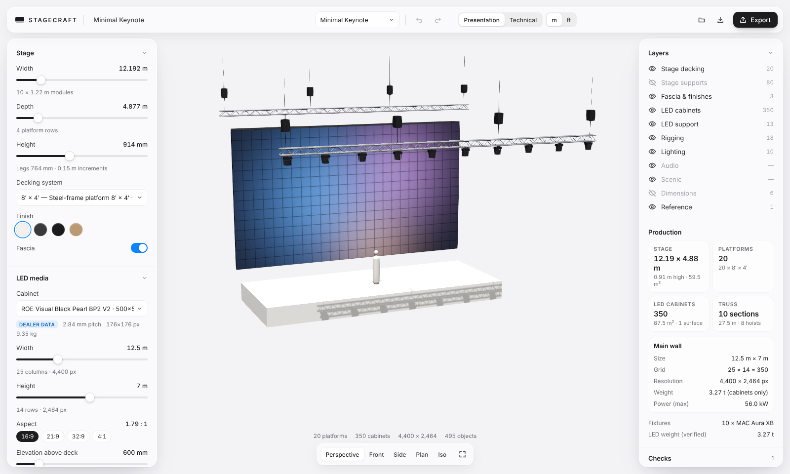

# STAGECRAFT

Parametric stage design configurator for keynotes, concerts, festival mainstages and immersive LED rooms — real equipment dimensions, a calm white spatial interface, and native, layered, editable **Rhino .3dm** export.

> Creative exploration → parametric configuration → production intelligence → professional CAD deliverable.



## Quick start

```bash
npm install
npm run dev          # http://localhost:5173  (?preset=panoramic-keynote etc.)
npm test             # engine + Rhino export tests
npm run export:samples   # samples/*.3dm, *.bom.csv, examples/*.stagecraft.json
pip install rhino3dm && npm run verify:3dm   # independent check with McNeel's Python rhino3dm
```

Requires Node 20+ (tested on 22). No backend, no paid services; Rhino export runs in the browser via McNeel's `rhino3dm` WASM.

## Using it
1. Pick a preset from the gallery in the toolbar: 21 presets in four categories (Tech & Brand, Concert & Touring, EDM & Festival, Cinematic & Immersive). See [docs/PRESETS.md](docs/PRESETS.md).
2. Drag sliders — stage and LED move in valid modular steps. Click any value to type an exact one (`12.5`, `40'6"`, `4500mm`); if it isn't buildable you'll see the nearest valid options.
3. Orbit (drag), pan (right-drag), zoom (scroll). Views: **1** perspective · **2** front · **3** side · **4** plan · **5** iso · **6** house (stage + audience). **T** toggles Technical mode.
4. Click an object to inspect its system; click again to inspect the single component. A selected LED wall, front truss or seating block shows axis handles: drag a handle to move along that axis (Alt for 1 mm steps).
5. **Audience**: pick Block, Grid or Radial and slide the seat count (250–5000 in 250s). Spacing starts at common US assembly practice and the row clear width is checked against code; see docs/ROADMAP.md for what is and isn't checked.
6. **Media** (toolbar): click **Add media** and pick an image, or drop one anywhere on the page. It is mapped across every screen with its centre pinned to the centre of the main screen, and it re-fits live as you resize or move walls. Choose **Span all screens** (a panorama or background) or **Fit main screen** (a logo). The menu shows the content canvas in pixels and can download a pixel-map template for the content team.
7. **Broadcast** (left panel): IMAG cameras with operators, a FOH camera platform, side cameras, a front rail with a robotic dolly, an RF handheld, presidential prompters, downstage and FOH confidence monitors. Everything re-positions as the stage and audience change. Click a camera (or the camera button in the view bar) to **look through it**: a lens-true 16:9 frame with Wide / Full / Medium / MCU / CU presets and a zoom slider that tells you when a shot needs the extender or is beyond the lens. **Esc** goes back.
8. **Structure** and **Show elements** (left panel): ground-support roofs, a mother grid and delay towers; a DJ booth and an LED dome. **Audience** also covers a standing GA floor with barricade and raked stands with a C-value sightline check.
9. **Export → .3dm** (Rhino 8 or 7; whole stage or selected systems), GLB, BOM CSV, or project JSON. Opening a STAGECRAFT .3dm in the app restores the parametric project.

## Coordinate system
Millimetres, Z up. Origin at floor level on the stage centreline at the downstage edge; +X house right, +Y upstage.

## Docs
- [Research](docs/RESEARCH.md) — stage design landscape, hardware catalogue, sources & verification status
- [Architecture](docs/ARCHITECTURE.md) — data model, pipeline, technology decisions, Rhino export plan, risks
- [Preset library](docs/PRESETS.md) — the 21 presets, the engine features behind them, sources
- [Roadmap & limitations](docs/ROADMAP.md)

Planning tool only — rigging, structural and load decisions require review by qualified engineers.
